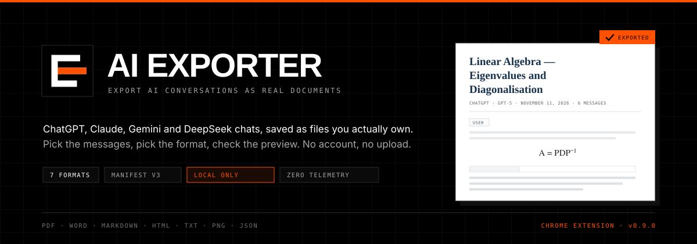
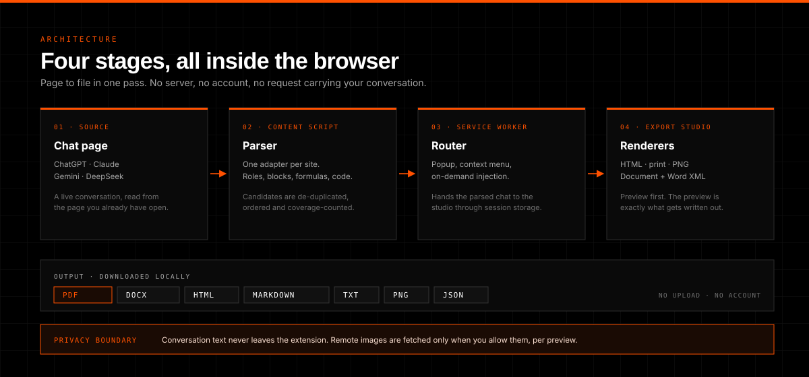
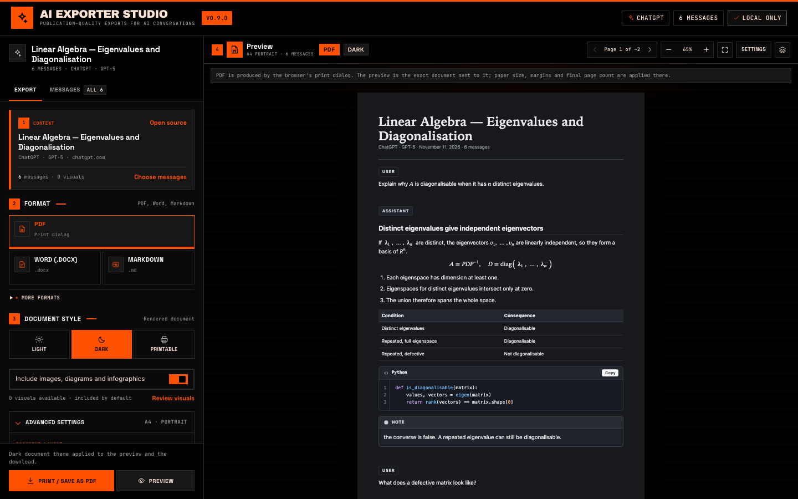
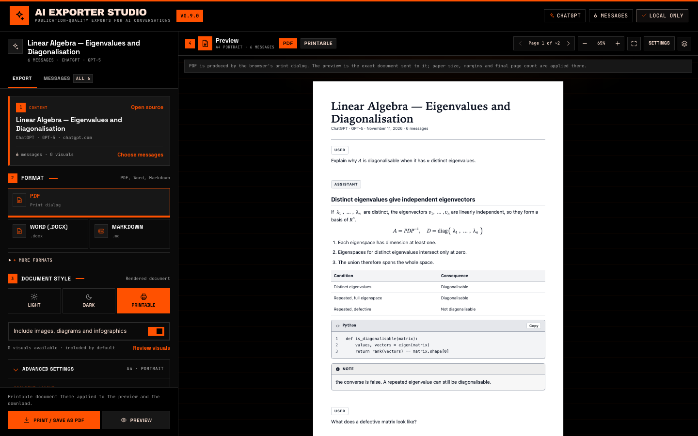
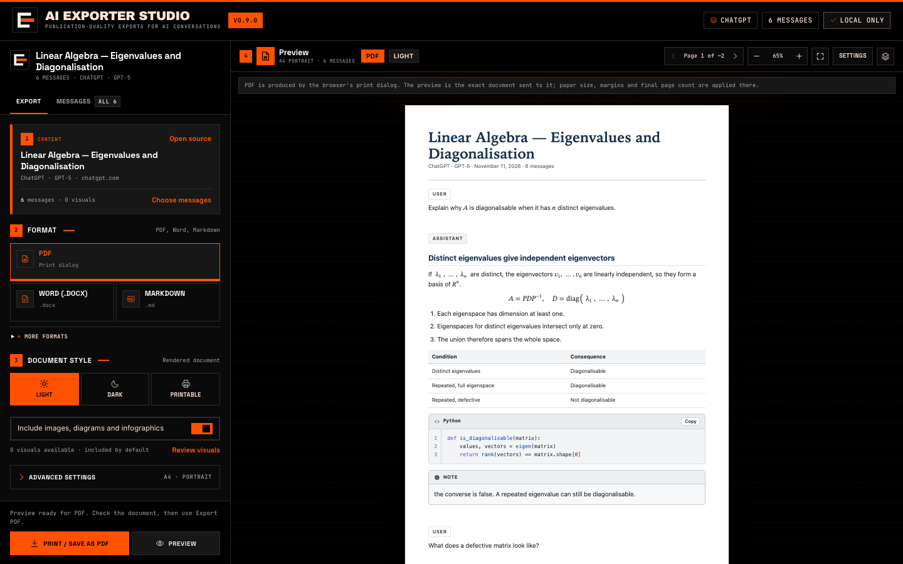
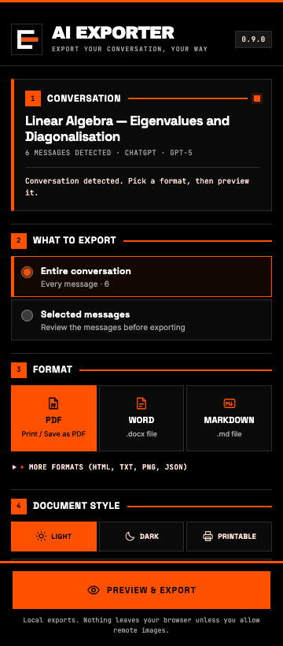
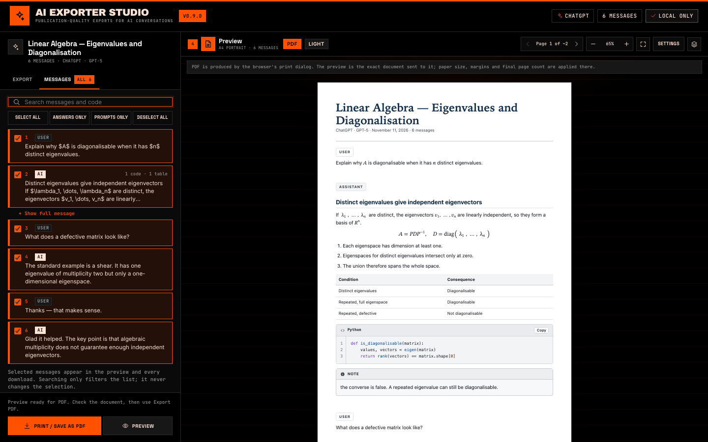
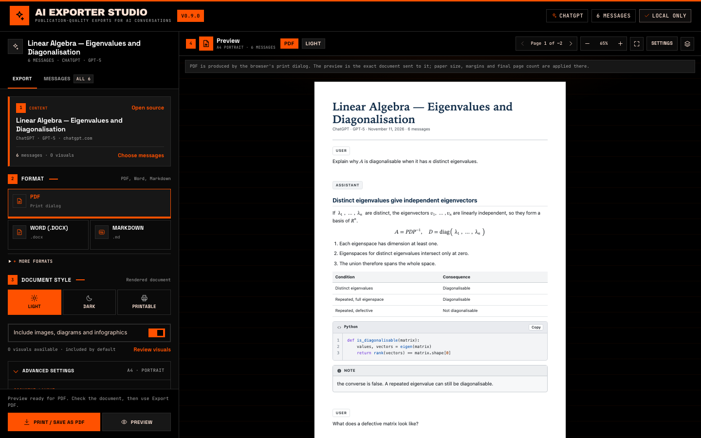

<p align="center">
  
</p>

<h1 align="center">AI Exporter</h1>

<p align="center">
  A Manifest V3 Chrome extension that turns a ChatGPT, Claude, Gemini or DeepSeek conversation into a document you own.<br>
  PDF, Word, HTML, Markdown, plain text, PNG or JSON — parsed from the page, previewed first, saved locally.
</p>

<p align="center">
  
  
  
  
</p>

<p align="center">
  <video src="https://github.com/tejasrajm46-strix/ai_exporter/raw/main/assets/AI_EXPORTER_INTRO.mp4" width="100%" controls muted playsinline poster="./assets/screenshots/studio.png">
    Picking Word as the format, switching the document to dark and exporting from the preview workspace.
  </video>
</p>

<p align="center"><sub>60-second walkthrough of the export workspace (mp4, no audio).</sub></p>

---

## What it does

A useful AI answer usually dies in a chat tab. Copying it into a document loses
the headings, the table, the mathematics and the code block; screenshotting it
loses the text.

AI Exporter reads the conversation you already have open, rebuilds its structure,
and writes it out as a real file. The preview inside the extension **is** the
document — the same HTML, the same pagination, the same figures — so nothing is
exported before you have seen it.

- No account, no API key, no server.
- Conversation text never leaves the browser.
- No exporter branding inside an exported file.

## Features

| Feature | What it does |
| --- | --- |
| **Seven formats** | PDF through the browser print dialog, a real `.docx`, standalone HTML with embedded images, Markdown, plain text, a long PNG poster and structured JSON for scripts. |
| **Choose the scope** | Export the whole conversation, or review messages first: search them, keep answers only, keep prompts only, or tick individual messages on the page itself. |
| **Three document styles** | Light paper, dark paper or a print-optimised theme, plus a separate black-and-white palette for Word. The interface theme never restyles a document. |
| **Structure survives** | Headings, nested lists, tables, quotes, notes, dividers, language-tagged code and syntax colouring are rebuilt as document blocks instead of flattened text. |
| **Mathematics that reads** | KaTeX and MathML become real display and inline equations with before/after spacing, and a boxed answer stays boxed. |
| **Visual assets** | Images, diagrams, charts and infographics are listed in an asset drawer: include or exclude them, choose inline/centred/fit-to-page placement, keep captions and alt text. |
| **Typesetting controls** | A4 or Letter, portrait or landscape, margins, page-break policy, body and code font, type size, line spacing and paragraph spacing — applied to the preview and the download together. |
| **Recovers on its own** | A tab that was open before the extension was installed, reloaded or updated has no content script; the popup and the right-click action repair the page on demand instead of asking you to reload. |
| **Honest about failures** | When a message container is recognised but cannot be read, the popup and the workspace say how many messages were missed rather than exporting silently. |

## Supported sites

| Platform | Hosts | Notes |
| --- | --- | --- |
| ChatGPT | `chatgpt.com`, `chat.openai.com` | Both the classic turn markup and the newer per-account layout are handled. |
| Claude | `claude.ai` | Current and previous response containers. |
| Gemini | `gemini.google.com` | `user-query` / `model-response` custom elements. |
| DeepSeek | `deepseek.com` | Hashed class names, so the adapter leans on the stable answer body and a structural fallback. |

These four sites change their DOM without notice. Each is a small selector
adapter, and the parser de-duplicates candidates, prefers the container that can
name its own role, orders everything by document position and counts anything it
could not read.

## Install

Nothing is built and nothing is downloaded at runtime: the folder is the
extension.

1. **Get the folder.** Clone this repository, or download the release archive and
   unzip it. Either way you end up with a folder that contains `manifest.json`.
2. **Open the extensions page.** Go to `chrome://extensions` in Chrome, Edge,
   Brave or any Chromium browser.
3. **Turn on Developer mode** (top right).
4. **Choose “Load unpacked”** and select the folder that contains `manifest.json`.
5. **Pin the toolbar icon** so the popup is one click away.

Open a conversation on a supported site and click the icon. After pulling new
code, press the reload arrow on the extension card — an already-open tab then
repairs itself on the next click.

### What each permission is for

| Permission | Why it is requested |
| --- | --- |
| `activeTab` | Read the tab you clicked the icon on, without standing access to every site. |
| `scripting` | Inject the parser into a tab that was open before install or update. |
| `storage` | Remember your format and style choices; carry the parsed chat to the export tab. |
| `downloads` | Save the generated file. |
| `contextMenus` | Add **Export this AI chat** to the right-click menu. |
| Host permissions | The four supported chat hosts. Without them the page cannot be read or repaired. |

## Architecture

<p align="center">
  
</p>

| Stage | File | Responsibility |
| --- | --- | --- |
| 1 · Source | — | The conversation as rendered on the page you already have open. |
| 2 · Content script | `utils/parser.js`, `content/content.js` | Site adapters, block collection, maths normalisation, selection bar, in-page toast. |
| 3 · Service worker | `background/service_worker.js` | Context menu, on-demand content-script injection, opening the export tab. |
| 4 · Export studio | `export/`, `utils/exporter.js`, `utils/docx.js`, `utils/document-theme.js` | Document model, HTML/print/PNG renderers, Word OOXML writer, preview, downloads. |

## How it works

1. **Detect.** The popup asks the active tab for its state. The content script
   picks the adapter for the hostname, collects candidate message containers,
   removes nested duplicates, sorts them by document position and resolves the
   speaker for each one.
2. **Read.** Every message is walked once into typed blocks — heading,
   paragraph, list, quote, table, code, image, formula, divider — with inline
   emphasis and maths kept as markers. KaTeX annotations become `$…$` and display
   maths is split out of the paragraph that carried it. Nothing is re-parsed
   later, so every renderer sees the same structure.
3. **Hand off.** The popup stores the parsed chat in `chrome.storage.session`
   and opens the export workspace. The entry expires after ten minutes and is
   removed the moment the workspace reads it, so closing the popup can never
   interrupt an export.
4. **Render.** The studio builds the document once per change and shows it in a
   sandboxed frame. PDF prints that same document; Word writes OOXML from the
   same blocks and the same page geometry; HTML embeds its images; Markdown and
   text serialise the blocks; PNG rasterises the layout; JSON hands the
   structure over untouched.
5. **Explain.** Progress names the real stages, the success state names the real
   file, and a refusal from the browser becomes a visible error with a retry
   action instead of a silent failure.

### Two palettes, one boundary

The interface is jet black, soft white and flame orange. An exported document is
paper: white or charcoal, near-black ink, hairline rules, colour only where it
carries meaning. `utils/document-theme.js` owns the document palette and nothing
in the interface can restyle a page; no interface colour or logo reaches a file.

### Project layout

```text
STRIX_AI_Exporter/
├── manifest.json            MV3 manifest: permissions, hosts, entry points
├── background/
│   └── service_worker.js    context menu, injection, tab opening
├── content/
│   ├── content.js           message protocol, selection bar, toast
│   └── content.css          in-page selection UI
├── popup/                   detection screen: scope, format, style
├── export/                  export workspace: preview, settings, downloads
├── utils/
│   ├── parser.js            site adapters → typed blocks
│   ├── exporter.js          document model, HTML/print/PNG renderers
│   ├── docx.js              Word OOXML writer
│   ├── document-theme.js    the document palette
│   └── mcq.js               multi-choice grouping across renderers
├── ui/                      tokens, shared component layer, icons, WOFF2 fonts
├── icons/                   16 / 32 / 48 / 128 px toolbar icons
├── assets/                  README artwork and screenshots
├── tools/                   check.js, package.js
├── selftest.html            browser regression page
└── selftest.js              the checks themselves
```

## Formats

| Format | What you get | How it is produced |
| --- | --- | --- |
| PDF | Paged document, A4 or Letter | The preview document is printed; page count and final pagination come from the print dialog. |
| Word `.docx` | Editable headings, lists, tables, code, images, notes | OOXML written in the browser; equations keep their TeX source in Cambria Math. |
| HTML | One standalone page, images embedded | The exported document with inline styles. |
| Markdown | Headings, lists, tables, fenced code, image references | Serialised from the same blocks as the preview. |
| TXT | Reading copy without markup | Plain serialisation. |
| PNG | Long poster of the document | Rendered at 1.5× or 2× detail. |
| JSON | The parsed conversation, structured | Messages, roles, blocks, code and formulas. |

## Document design

Documents open on the conversation, not a cover: the title page is available in
**Advanced → Document layout** and off by default. Headings are navy on light
paper, body text is charcoal, mathematics is body ink, rules are hairlines and
tables keep minimal borders.

<p align="center">
  
  
</p>

## Screenshots

<p align="center">
  
</p>

<p align="center">
  
  
  
</p>

## Privacy

- No analytics, no telemetry, no remote fonts. All five typefaces are bundled
  WOFF2 files.
- The conversation is parsed and rendered inside the extension. There is no
  upload path in the code.
- Remote images are blocked unless you enable them for that preview. The
  workspace states that the image host can then see your IP address, and the
  choice is never saved.
- The parsed conversation lives in `chrome.storage.session`, expires after ten
  minutes, and is removed when the export view reads it.

## Development

```bash
npm run check      # node --check every script + verify manifest paths
npm run package    # build dist/AI_exported_0.9.zip (extension files only)
```

The self-check page exercises the real parser, exporter, document generator and
Word writer against synthetic fixtures — no real conversation and no network.
Serve the extension folder itself (the directory containing `manifest.json`),
because the interactive sample loads `export/` and `ui/` by relative path:

```bash
npx --yes serve -l 8080 .
# open http://localhost:8080/selftest.html
```

It must be served over HTTP rather than opened as a file, because the interactive
sample fetches `export/export.html` to boot the real controller. In 0.9.0 the
page reports **76 checks, 0 failures**. The page covers
the seven export paths, maths rendering, code highlighting, image handling,
selection rules, parsing, themes, advanced settings, the popup flow and the
controller's export/download behaviour.

The animation and diagrams in this README are generated from the extension's own
stylesheets, so the artwork cannot drift from the shipped interface.

## Limitations

- PDF is produced by the browser print dialog; the final page count and
  pagination are applied there.
- Word equations keep their TeX source set in Cambria Math. They are readable
  but not editable OMML equations.
- The supported sites change their markup regularly. A redesigned layout can
  reduce what is parsed; the extension reports missing messages instead of
  exporting a partial conversation quietly.
- Live signed-in parsing on the four sites is not covered by the automated
  checks; the fixtures reproduce their document structure.

## License

MIT — see [LICENSE](./LICENSE).
