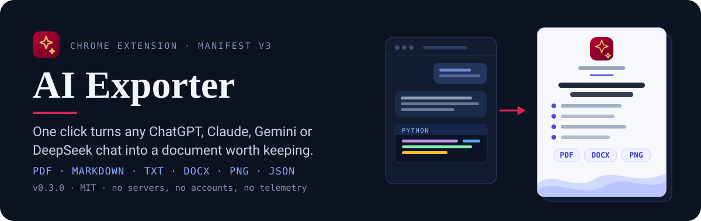
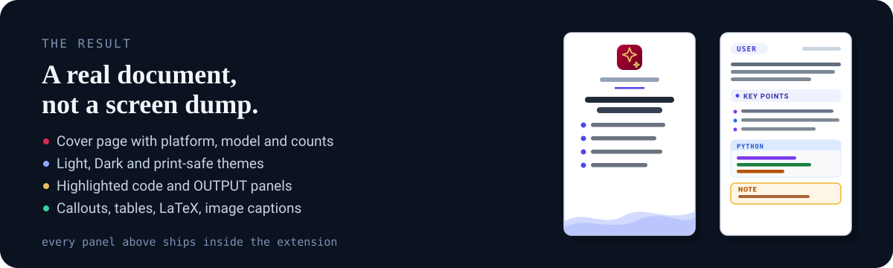
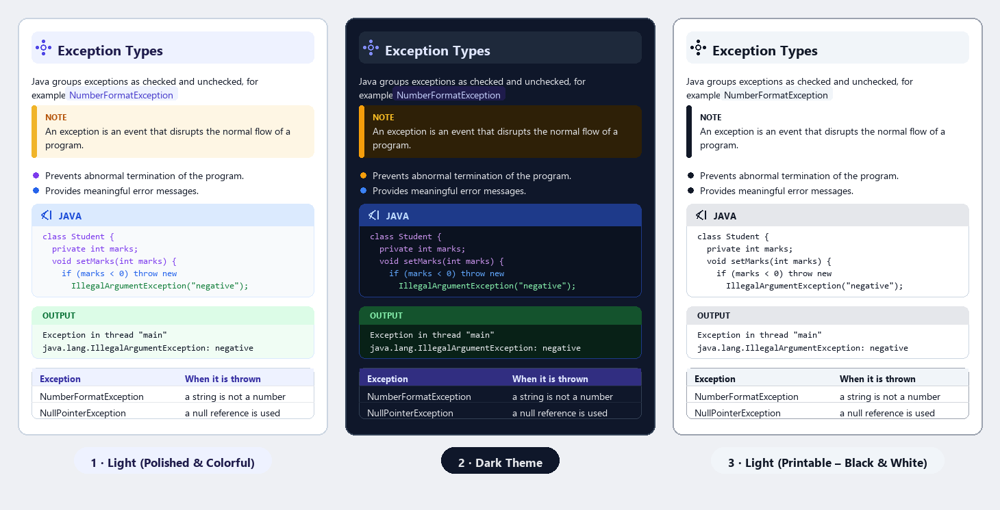
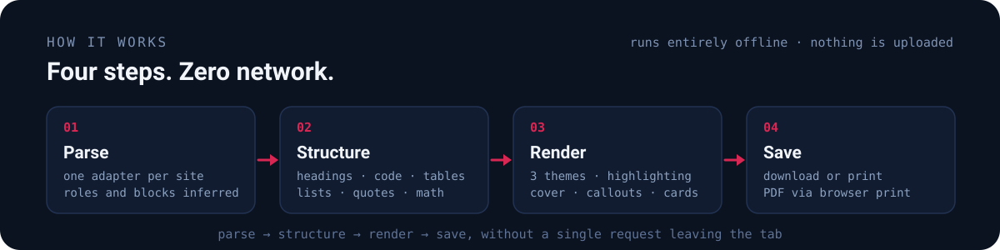

<div align="center">



[](#install)
[]()
[](#supported-platforms)
[](#six-formats-one-conversation)
[](#privacy-by-design)
[](#how-it-works)
[](#license)

**Your AI conversations are worth keeping. AI Exporter turns them into documents worth sharing — without a single byte leaving your machine.**

[Install](#install) · [Formats](#six-formats-one-conversation) · [How it works](#how-it-works) · [Examples](#what-an-export-actually-contains) · [Privacy](#privacy-by-design)

</div>

---

## Why it exists

Copy-pasting a chat is where good conversations go to die: code loses its fences, tables collapse into mush, math turns into gibberish, and web converters ask you to upload your private data to somebody else's server.

AI Exporter takes a different path. It reads the conversation directly in the page, rebuilds its real structure, and renders a finished document — all inside your browser:

- **Code stays code** — fenced blocks with detected language, syntax highlighting and `OUTPUT` panels
- **Structure stays structure** — headings, lists, tables, quotes, LaTeX and image captions survive the trip
- **Privacy stays private** — no servers, no accounts, no telemetry; parsing, rendering and saving happen in your own tab

## Supported platforms

| Platform | Status | Notes |
| --- | :---: | --- |
| **ChatGPT** | ✓ | Verified on live conversations — handles both the classic turn layout *and* the newer Chat / Work layout |
| **Claude** (`claude.ai`) | ✓ | Dedicated adapter covering current and older response class names |
| **Google Gemini** | ✓ | Dedicated adapter for its custom elements |
| **DeepSeek** | ✓ | Thin adapter + structural fallback for its hashed class names |
| Other AI sites | ◐ | Best-effort: only highly specific chat hooks are trusted — page chrome is never exported |

These apps redesign their DOM without notice — if a page ever stops being detected, refresh and report it; the extension names exactly which selectors it tried.

Three ways to fire it: the **toolbar popup**, the **right-click menu** (*"Export this AI chat"*), or the **in-page selection bar**.

## Six formats, one conversation

| Format | File | How it's produced | Best for |
| --- | --- | --- | --- |
| **PDF** | `.pdf` | Your browser's real print pipeline — selectable text, true A4 page breaks, a designed cover page | Sharing, archiving, printing |
| **Markdown** | `.md` | GitHub-flavored Markdown with fenced code, tables, quotes and LaTeX | Notes, Obsidian, READMEs |
| **Plain text** | `.txt` | Cleanly indented transcript, no markup | Email, logs, quick reads |
| **Word** | `.doc` | Word-compatible HTML with a colour / black-and-white switch | Editing and handing in |
| **Image** | `.png` | A 2× canvas poster of the whole conversation | Chats that look good in chat |
| **JSON** | `.json` | The full structured block model plus metadata | Backups, pipelines, analysis |

> [!TIP]
> Every export opens in a **live preview first** — a zoomable A4 sheet with an estimated page count — so you always see exactly what you're about to save. Choosing PDF opens the print dialog automatically.

## Documents that feel designed



The renderer rebuilds your conversation as a typeset document, not a raw dump:

- **Cover page** — title, platform, model name, message count, export date and format
- **Transcript flow** — one section per turn with role chips (`USER` / `ASSISTANT`) and optional timestamps
- **Three themes** — Light (colourful), Dark (navy reading theme), and Print (every colour collapsed to ink, so a photocopier reproduces it exactly)
- **Smart code** — language detection from classes, attributes and header labels; a compact regex tokenizer colours keywords, strings, numbers and comments; `Output:` + code merges into a green **OUTPUT** panel
- **Reading aids** — quotes starting with *Note / Tip / Key point* become callouts; *Summary* and *Next steps* headings become tick-list cards
- **Real content** — tables with tinted headers, LaTeX formulas, images with numbered captions, ordered lists that keep their numbers
- **Word-safe** — the `.doc` export inlines every style variable and ships a plain-HTML fallback, because Word's parser skips flexbox, grids and CSS variables

### See the real thing

Every sample below is a full export of the same conversation — one per theme:

| Sample | Look |
| --- | --- |
| [Light PDF](assets/sample-light.pdf) | Colourful — indigo accents, lavender section bars, amber notes |
| [Dark PDF](assets/sample-dark.pdf) | Navy surfaces for evening reading |
| [Print PDF](assets/sample-print.pdf) | Every colour collapsed to ink — photocopy-proof |



## Export exactly what you want

Two selection passes, zero re-parsing:

1. **On the page** — click *Select messages* in the popup. Checkboxes appear on every message with a floating bar showing the count; pick some, choose a format, hit **Export selected**. Press <kbd>Esc</kbd> to leave. The selection re-syncs live as the page changes.
2. **In the preview** — the export view adds a second, finer picker: tick individual turns (or use the one-click **Everything / Answers / Prompts** selectors) and the preview, the print dialog and every download follow your choice instantly.

## How it works



- **Site-aware parsing** — one small adapter per platform; candidates are de-duplicated, containment-filtered, ordered by document position and role-validated. When nothing plausible is found it says so — with the exact selectors that missed — instead of exporting page chrome.
- **One block model** — every message becomes typed blocks (heading, paragraph, list, quote, code, table, image, formula, divider) so no exporter ever re-parses HTML.
- **Pure, local rendering** — Markdown/TXT/JSON built from the block model; documents assembled from one stylesheet with three palettes; PNG posters measured first, then painted at 2×.
- **Zero dependencies** — no npm, no vendored libraries, nothing fetched at runtime.

## Install

### From a release (recommended)

1. Grab the latest `ai_exporter` zip from **[Releases](https://github.com/tejasrajm46-strix/ai_exporter/releases)** and unzip it
2. Open `chrome://extensions` (works in Chrome, Edge, Brave and other Chromium browsers)
3. Toggle **Developer mode** (top-right)
4. Click **Load unpacked** and pick the unzipped folder
5. Pin **AI Exporter** from the puzzle-piece menu

### From source

```bash
git clone https://github.com/tejasrajm46-strix/ai_exporter.git
```

Then the same as above — load the cloned folder as an unpacked extension.

## Use it

1. Open any conversation on ChatGPT, Claude, Gemini or DeepSeek
2. Click the **AI Exporter** icon — or right-click the page → *Export this AI chat*
3. Pick a format (whole chat, or *Select messages* for a custom cut)
4. Review the live preview and **save**

| Setting | What it does |
| --- | --- |
| Include timestamps | Stamps every turn in PDF, Word, Markdown and text exports |
| Preserve code highlighting | Toggles the syntax colouring in rendered documents |
| Document theme | Light (colourful) · Dark · Light (printable) |
| Word document | Light & colourful · Clean black & white |

## What an export actually contains

**Markdown** — structure preserved, ready for your notes app:

````markdown
# Debugging a Python WebSocket client

> Exported from ChatGPT (GPT-4o) with AI Exporter
> 12 October 2026 at 14:32 - 6 messages

## User

Why does my `websockets` client drop the connection after 30 seconds?

## Assistant

The server is closing the idle socket. Add a heartbeat:

```python
async def heartbeat(ws):
    while True:
        await asyncio.sleep(20)
        await ws.ping()
```

| Setting         | Default | Suggested |
| --------------- | ------- | --------- |
| `ping_interval` | 20      | 20        |
| `ping_timeout`  | 20      | 60        |

> Note: keep the heartbeat shorter than the proxy idle timeout.

$$
\text{timeout} > 2 \times \text{interval}
$$
````

**JSON** — the complete block model, ready for tooling:

```json
{
  "version": 1,
  "title": "Debugging a Python WebSocket client",
  "platform": "chatgpt",
  "platformLabel": "ChatGPT",
  "model": "GPT-4o",
  "exportedAt": "2026-10-12T14:32:08.512Z",
  "messageCount": 6,
  "messages": [
    {
      "id": "msg-1",
      "index": 0,
      "role": "user",
      "text": "Why does my `websockets` client drop the connection after 30 seconds?",
      "blocks": [
        { "type": "paragraph", "text": "Why does my `websockets` client drop the connection after 30 seconds?" }
      ],
      "codeBlocks": [],
      "formulas": [],
      "timestamp": null
    }
  ],
  "export": {
    "generator": "AI Exporter 0.3.0",
    "theme": "light",
    "docMode": "color",
    "timestamps": false,
    "highlight": true
  }
}
```

## Privacy by design

The entire pipeline is local. The service worker never touches file data; the export view holds the parsed chat in memory for the life of its tab and clears the stashed copy once read. No conversation content is ever written to storage.

> [!IMPORTANT]
> **Your conversation stays on this device.** No servers, no accounts, no analytics — the extension makes zero network requests of its own.

| Permission | Why it's needed |
| --- | --- |
| `activeTab` + `scripting` | Read the conversation on the page you're viewing |
| `storage` | Remember your export settings — never conversation content |
| `downloads` | Save the files you export |
| `contextMenus` | The right-click *"Export this AI chat"* entry |
| Host permissions | Run only on ChatGPT, Claude, Gemini and DeepSeek |

Defense-in-depth for the exported files themselves: every page-provided string is HTML-escaped before it enters a document, exports carry a `script-src 'none'` CSP, image sources must be a raster data URI or an https URL (no `javascript:`, no SVG documents), remote images are fetched with `no-referrer`, and the background worker re-validates every payload from scratch before opening the preview.

## Honest limits

- Exports are capped at **4,000 messages / 8 MB** — beyond that you'll get a clear message instead of a broken file
- The PNG poster is a picture of your chat — beautiful, but not searchable like the PDF
- These sites redesign their DOM without warning; if a page suddenly isn't detected, **refresh and retry** — the extension tells you exactly which selectors it tried, which makes fixes quick
- Very long code blocks can affect the page estimate in the preview; the printed page breaks are always handled by the browser itself

## Project layout

```text
ai_exporter/
├─ manifest.json            # MV3 manifest: permissions, CSP, injection targets
├─ background/
│  └─ service_worker.js     # context menu · payload sanitizer · view launcher
├─ content/
│  ├─ content.js            # selection mode, floating bar, messaging
│  └─ content.css           # injected checkboxes and action-bar styles
├─ export/
│  ├─ export.html/.js/.css  # the export view: preview, picker, downloads, print
├─ utils/
│  ├─ parser.js             # site-aware DOM → block-model parser
│  └─ exporter.js           # pure, local conversion engine (all six formats)
└─ icons/                   # toolbar icons
```

## FAQ

<details>
<summary><b>Does my conversation get uploaded anywhere?</b></summary>
No. Parsing happens in the page, rendering happens in a local extension page, and saving happens through your browser's own download and print pipelines. There is no server to upload to.
</details>

<br>

<details>
<summary><b>Why is the PDF produced by the print dialog?</b></summary>
Because the browser's print pipeline gives you selectable text, real page breaks and your own paper size choices — instead of a rasterized screenshot of a web page.
</details>

<br>

<details>
<summary><b>A page suddenly stopped being detected.</b></summary>
Refresh the tab and try again. These apps ship new layouts to accounts gradually; AI Exporter already handles ChatGPT's two layouts and DeepSeek's rotating class names, and when detection fails it names the selectors it tried so issues are easy to report.
</details>

<br>

<details>
<summary><b>Can I export just part of a conversation?</b></summary>
Yes — twice over. Tick messages on the page with <i>Select messages</i>, then refine further with the per-turn picker inside the export preview.
</details>

## Contributing

Issues and pull requests are welcome — especially parser adapters for new platforms. If a site changed its DOM, open an issue with the diagnostics message the popup showed you; it lists exactly what went missing.

Changes can be checked without loading the extension:

```bash
python -m http.server 8765
```

Then open `http://localhost:8765/selftest.html` — it exercises the parser and the export engine right in the browser.

## License

[MIT](LICENSE) — free to use, study, modify and ship.

---

<div align="center">

<a href="https://github.com/oil-oil/beautify-github-readme"></a>

**AI Exporter** · v0.3.0 · Made for people who keep their conversations

</div>
